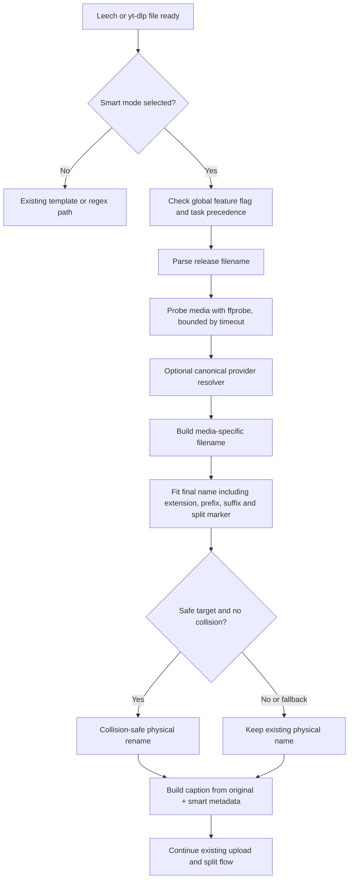

# Smart Auto Rename (AZML-Go)

## Overview

Smart Auto Rename is an opt-in, metadata-driven rename mode ported in concept from WZMLHK-X's Smart Auto Rename pipeline. It does not replace AZML-Go's existing template or regex modes. It adds an alternate flow that parses a release filename, optionally probes the media with `ffprobe`, optionally resolves a canonical title through external providers, builds a standardized name, fits the final name to a character budget, then renames the file without overwriting an existing target.

The implementation uses only Go and the standard library for the new provider HTTP clients. It does not invoke Python or introduce a Python runtime requirement.

## Architecture



The main entry point is `helper/ext/smart_autorename.go:SmartAutoRename`. The shared pipeline helper `PrepareSmartRename` is used by standard leech and yt-dlp, avoiding separate smart rename implementations for each downloader.

| Component | Responsibility |
|---|---|
| `helper/ext/smart_filename_parser.go` | Media type classification, title/year/episode/range/season-pack extraction, technical hints, anime markers, multipart suffixes, release group and encoder hints. |
| `helper/ext/smart_media_probe.go` | Context-bound `ffprobe` invocation and typed stream metadata for video, audio and subtitles. |
| `helper/ext/smart_metadata_resolver.go` | Optional TMDb, Kitsu and Cinemeta adapters, title/year scoring, provider priority, timeouts, bounded retries, cache and duplicate-request coalescing. |
| `helper/ext/smart_filename_builder.go` | Canonical-name assembly, sanitization, Unicode-safe length fitting and no-overwrite file rename helper. |
| `helper/ext/smart_autorename.go` | Orchestration, results/warnings, settings conversion and logging. |
| `helper/ext/smart_caption.go` | V1/V2 Smart Caption rendering and backward-compatible template expansion. |
| `helper/ext/smart_autorename_test.go` | Offline parser, builder, fitter, ffprobe, provider HTTP, caption, fallback and collision tests. |

## Enablement and user commands

Smart is **not selected automatically for existing users**. Existing `RenameMethod=auto` records continue to use the current template mode.

Use one of these commands to select Smart mode:

```text
/ar mode smart
/ar smart
```

Use the per-user settings menu's **Rename Method** button to cycle through Template → Regex → Smart → Template. The existing commands still work:

```text
/ar <template>      Save a template and select Template mode
/ar mode auto       Select existing template mode
/ar mode regex      Select existing regex mode
/ar off             Clear the stored template (existing semantics; does not itself disable AutoRename)
```

Auto Rename must also be enabled for that user. An explicit custom filename takes precedence over Smart mode in the standard leech flow. Existing template syntax and regex configuration remain available.

## Configuration

The following settings are read from `config.env` / the process environment. Values below are defaults used by the Go configuration loader.

| Variable | Default | Behavior |
|---|---:|---|
| `SMART_AUTORENAME_ENABLED` | `True` | Global gate allowing per-user Smart mode. Smart still requires the user to select `RenameMethod=smart` and have Auto Rename enabled. |
| `SMART_AUTORENAME_LOOKUP_ENABLED` | `True` | Allows optional external canonical metadata lookups. Set `False` for local parsing and probing only. |
| `SMART_AUTORENAME_PROVIDER_PRIORITY` | `kitsu,tmdb,cinemeta` | Comma-separated order. Supported entries are `kitsu`, `tmdb`, `cinemeta`; listing an entry enables it. Kitsu is only queried for anime-marked files. TMDb also requires `TMDB_ACCESS_TOKEN`. |
| `SMART_AUTORENAME_MAX_CHARS` | `60` | Maximum Unicode code points in the complete final filename, including extension, configured prefix/suffix and multipart marker. |
| `SMART_AUTORENAME_PROBE_TIMEOUT` | `12` | Per-file ffprobe timeout in seconds. Probe failure is non-fatal. |
| `SMART_AUTORENAME_LOOKUP_TIMEOUT` | `8` | Overall provider lookup timeout in seconds for one file. |
| `TMDB_ACCESS_TOKEN` | Existing AZML-Go setting; no token by default | TMDb bearer token or API key. Credentials are never intended to be logged. |

The existing global and per-user leech prefix/suffix and caption settings are reused. Prefix/suffix changes are accounted for in the filename fitter. Use a sensible `SMART_AUTORENAME_MAX_CHARS`; if mandatory components cannot fit, Smart keeps the original file name and records a warning.

## Implemented pipeline behavior

1. **Eligibility and precedence:** the shared function only handles regular, non-symlink video files with a supported media extension. It is invoked in leech and yt-dlp only when the user's Auto Rename is on, the method is `smart`, and the global Smart gate is on. Explicit custom names skip Smart in the standard leech flow. Template/regex are not run as a hidden fallback for a selected Smart mode.
2. **Filename parsing:** supports movie-like names with/without a year when enough release evidence exists; `SxxExx` episodes; multi-episode ranges such as `S02E05-E06`; anime forms such as `Title - 012` and `Title - E361`; season packs; Unicode titles; resolution/source/codec/audio/HDR/subtitle hints; and split suffixes such as `.part01.mkv`, `.mkv.001`, and `.mkv.part01`. Parse confidence and warnings are retained in the result.
3. **Media probe:** uses `ffprobe -show_streams -show_format -of json` under a context timeout. Width/height-derived resolution, video codec, bit depth, HDR indicators, audio streams/languages/layouts/bitrate, subtitle languages/default/forced flags, and duration are collected only when present. Actual stream values take precedence over filename hints for the same fields. Probe failures degrade to filename evidence.
4. **Canonical lookup:** provider results are evaluated against the parsed title and year. Low-scoring candidates are rejected; close, differently titled candidates are flagged as ambiguous. Movie and TV TMDb searches use the parsed media category, and a resolved TV series can be queried for an episode title. Cache keys include title, year, media type, anime flag, token, and provider order. Positive and negative results have separate TTLs. Requests are bounded and at most one retry is attempted for HTTP 429/5xx responses.
5. **Name building:** generates different shapes for movies, episodes/ranges, anime episodes and season packs. Technical tokens are included only when available. Unknown media identity falls back without fabricating a title/year/episode. The fitter removes optional audio/subtitle/platform/source/codec/HDR/bit-depth/episode-title components before shortening the title; it preserves the extension and episode/split identity when possible.
6. **Filesystem behavior:** Smart refuses directory traversal names, symlinks, and special files. It uses a same-directory hard-link then unlink operation that fails if the target already exists; it deliberately does not fall back to an overwriting rename if hard links are unsupported. A filesystem failure leaves the original tracked path in the result, along with a warning.
7. **Original names and captions:** the original incoming filename is held separately from the proposed and physical filenames. Smart captions support the existing `{filename}`, `{size}`, `{duration}`, `{quality}`, `{languages}`, and `{subtitles}` placeholders plus `{orig_filename}`, `{smart_filename}`, `{show_name}`, `{season}`, `{episode}`, `{year}`, `{source}`, `{platform}`, `{codec}`, `{audio_summary}`, `{subtitle}`, `{hdr}`, `{bit_depth}`, `{release_group}`, and `{encoder}`. Unknown placeholders become empty strings. Placeholder values are HTML-escaped so incoming filenames do not break HTML-mode captions.
8. **Split files:** the pre-existing split pipeline remains after rename. A parsed source part's suffix is preserved during Smart naming; normal AZML-Go large-file splitting still uses its existing code. Captions preserve the OG name captured before rename.

## Example outputs

These outputs assume no prefix/suffix, canonical lookup either agrees with the local title or is disabled, and the file stream does not contradict the filename hints.

| Input | Expected normalized shape |
|---|---|
| `Example.Movie.2024.1080p.WEB-DL.x265.mkv` | `Example Movie (2024) [1080p] [WEB-DL] [HEVC].mkv` |
| `Example.Show.S02E05.The.Final.Battle.1080p.WEB-DL.x265.mkv` | `Example Show S02E05 The Final Battle [1080p] [WEB-DL] [HEVC].mkv` |
| `Example.Show.S02E05-E06.720p.mkv` | `Example Show S02E05-E06 [720p].mkv` |
| `Example Anime - 012 [1080p].mkv` | `Example Anime - 012 [1080p].mkv` |
| `Example.Show.S02.COMPLETE.1080p.mkv` | `Example Show - Season 02 [1080p].mkv` |
| `Example.Movie.2024.2160p.WEB-DL.DV.HDR.HEVC.mkv` | Movie title/year plus verified/hinted `2160p`, source, HEVC and HDR components, only within the configured length budget. |

These are intended shapes rather than assertions that every possible filename/provider response yields identical output. On an ambiguous input the engine may keep the original name.

## Providers and explicit limitations

- **TMDb:** implemented with `/search/movie`, `/search/tv`, and TV season/episode detail endpoints. Uses existing `TMDB_ACCESS_TOKEN`; short tokens are passed as `api_key`, longer tokens as bearer authorization.
- **Kitsu:** implemented against the public Kitsu JSON:API anime search endpoint; queried only when filename parsing marks the release as anime.
- **Cinemeta:** implemented against the Stremio Cinemeta search catalog for movies/series.
- **IMDb:** no direct IMDb adapter is implemented in this port. The Python reference's `imdbio` integration is not blindly replicated in Go.
- **TVDB:** no direct TVDB API adapter is implemented. In the supplied WZMLHK-X reference snapshot, the class named `TVDBProvider` delegates lookup to Cinemeta, so the class name is not evidence of a direct TVDB API call.
- **Episode data:** TMDb may provide a TV episode title after a series match. Cinemeta/Kitsu lookup results currently canonicalize the series/title, not every individual episode field.

External lookup is optional. It may be turned off globally and is never required for parsing, probing, or filename generation.

## Error and fallback policy

| Condition | Behavior |
|---|---|
| Missing `ffprobe`, invalid media, timeout or non-zero exit | Warn; use filename hints. No file is deleted because of probe failure. |
| Providers unavailable, no token/results, or timeout | Warn if an error occurred; use locally parsed title and technical hints. |
| Low-confidence/ambiguous provider candidates | Reject the weak result and preserve local metadata. |
| Insufficient title/media evidence | Skip rename and keep the input path. |
| Fitter cannot meet the limit | Keep the original filename and warn rather than failing the upload solely for optional metadata. |
| Destination already exists / rename fails | Do not overwrite. Keep the original path and report the failed rename in result warnings/status. |
| Context cancellation | Return cancellation; callers keep their current tracked path. |

## Development and verification

Prerequisites:

- Go version matching the repository's `go.mod` (currently `go 1.25.0`).
- `ffprobe` from an FFmpeg installation for stream-aware naming; it is optional at runtime.
- Network access only when optional external canonical lookup is enabled.
- `TMDB_ACCESS_TOKEN` only for TMDb lookup. Kitsu and Cinemeta are public endpoints in this implementation.

Commands:

```bash
gofmt -w config/config.go helper/ext/smart_*.go modules/settings.go modules/leech.go modules/ytdl.go
go test ./...
go vet ./...
```

Provider tests use local `httptest` servers and do not require real API keys or live services. No full repository test or build is claimed by this report when the repository-required Go toolchain or dependency downloads are unavailable; see the implementation report/verification notes for the actual environment result.


For caption placeholders and V1/V2 behavior, see [Smart Caption documentation](SMART_CAPTION.md).
